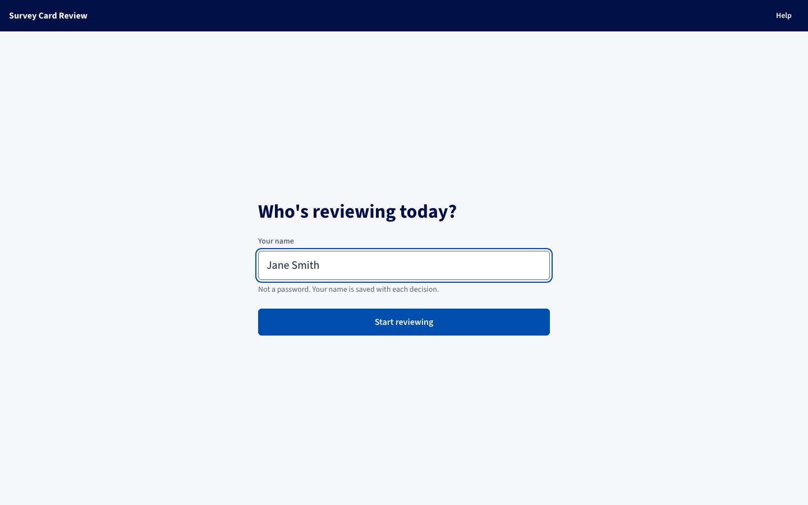
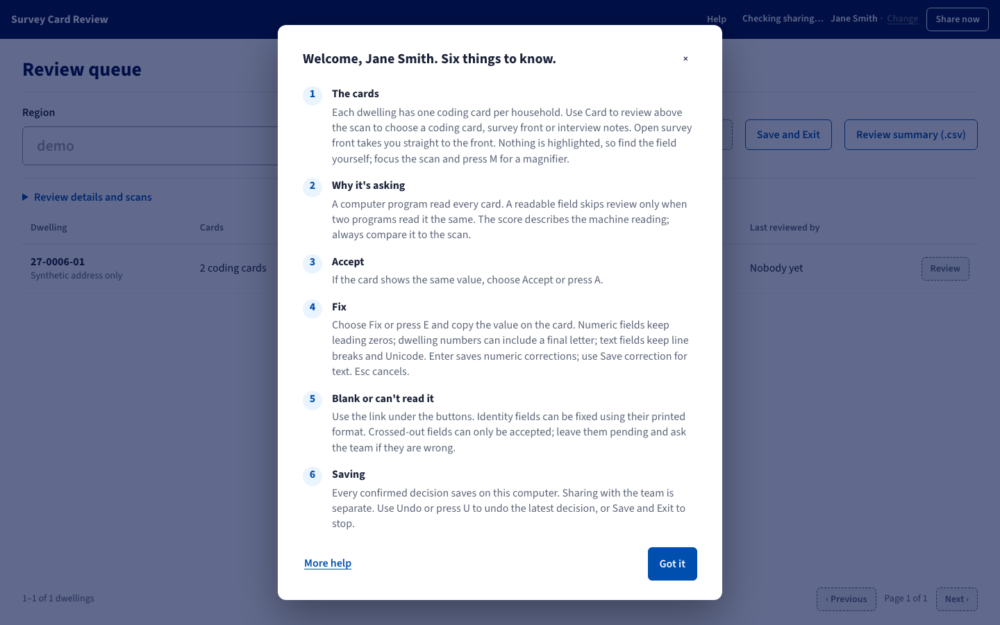
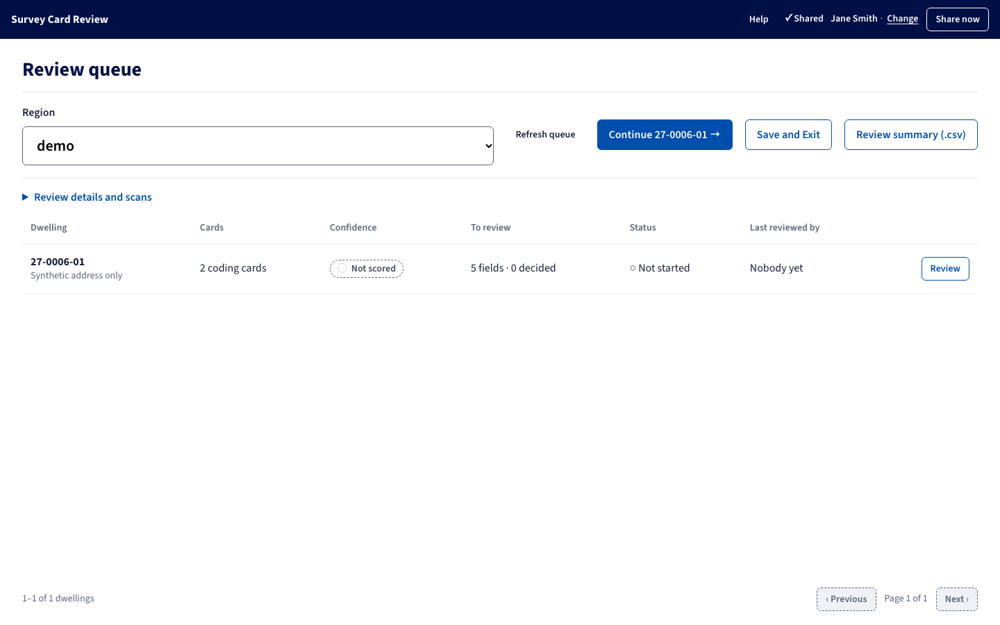
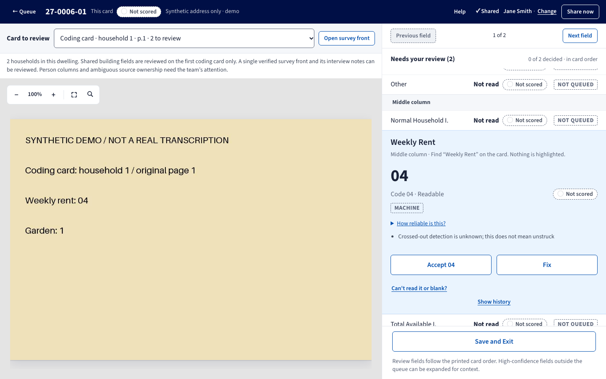
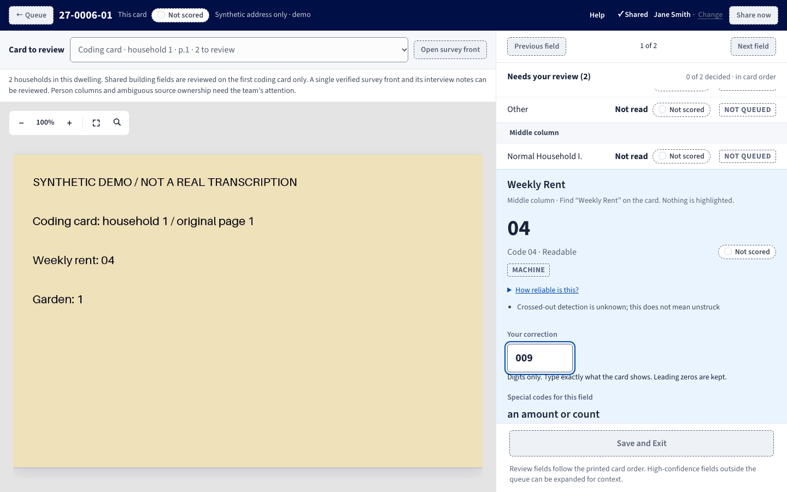
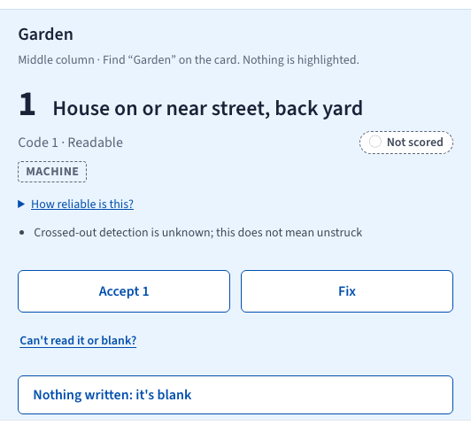
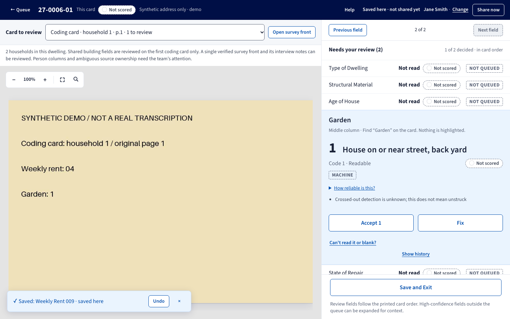
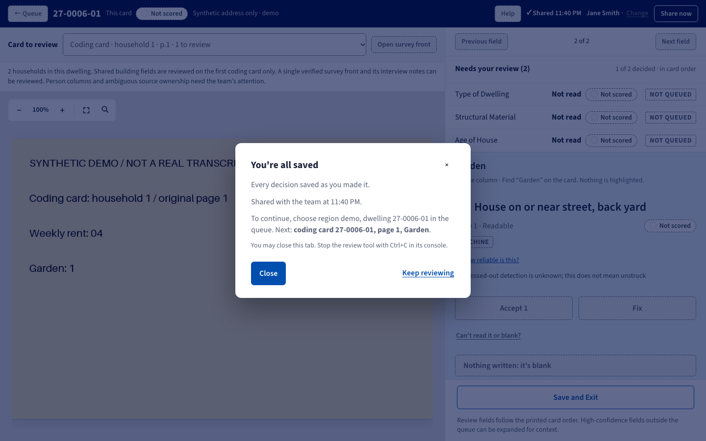

# Survey Card Review: user manual

Check the fields the extraction wasn't sure about against the original scan,
and fix the ones it got wrong.

| Section | Jump to |
| --- | --- |
| **[Setup](#setup)**<br>Once per computer, about 30 min | [Install](#1-install-git-and-uv) · [Code](#2-get-the-code) · [Data](#3-get-the-data) · [GitHub sign-in](#4-sign-in-to-github) · [Review list](#5-make-the-review-list) · [Settings](#6-fill-in-the-settings-file) · [Drive API key](#7-set-up-scan-downloads-optional) · [Shortcut](#8-make-a-desktop-shortcut) |
| **[Reviewing](#reviewing)**<br>Every session | [Start](#start-the-tool) · [Sign in](#sign-in) · [Pick a dwelling](#pick-a-dwelling) · [Scans](#getting-the-scans) · [Review screen](#the-review-screen) · [Decide](#make-a-decision) · [Undo](#undo) · [Shortcuts](#keyboard-shortcuts) |
| **[Saving and sharing](#saving-and-sharing)** | [Saving](#saving) · [Sharing](#sharing) · [Stopping](#stopping) |
| **[Troubleshooting](#troubleshooting)** | Errors and what to do |
| **[Practice run](#practice-run)** | Try it on fake data first |

**Every field gets one of four answers:**

| The card shows | You choose |
| --- | --- |
| The same value | **Accept** (A) |
| A different value | **Fix** (E), type it, Enter |
| Nothing | **Can't read it or blank?** → **Nothing written** |
| Something unreadable | **Can't read it or blank?** → **Something's there but I can't read it** |

> Screenshots use the built-in practice data, so the scan is a plain stand-in
> card.

---

## Setup

Once per computer. You will end up with four folders and one settings file:

| What | Example (Windows) | What it holds |
| --- | --- | --- |
| Code folder | `C:\Survey Review\survey-review` | The tool itself |
| Data folder | `C:\Survey Review Data` | The results you are correcting |
| Scans folder | `C:\Survey Scans` | The original PDFs |
| Cache folder | `C:\Survey Review Cache` | Temporary page images. Safe to delete. |
| Settings file | `C:\Survey Review\survey-review\.env` | Tells the tool where the other folders are |

Keep the four folders separate. Don't put one inside another.

### 1. Install Git and uv

- **Git:** download it from [git-scm.com](https://git-scm.com/downloads) and
  accept the defaults.
- **uv:** open Command Prompt and run

  ```bat
  winget install --id=astral-sh.uv
  ```

  On a Mac, use `brew install uv` instead.

Close Command Prompt and open a new one so it picks up both.

### 2. Get the code

```bat
git clone https://github.com/skandaramanan/IT-Project-T8-6.git "C:\Survey Review\survey-review"
cd /d "C:\Survey Review\survey-review"
uv sync --locked
```

`uv sync` downloads Python and everything the tool needs. The first time takes
a minute or two.

If the team gave you a ZIP of the tool, unzip it to the code folder instead of
running `git clone`. Then run the last two lines.

### 3. Get the data

The results you correct live on a separate branch called `review-data`. Clone
that branch into its own folder:

```bat
git clone --branch review-data https://github.com/skandaramanan/IT-Project-T8-6.git "C:\Survey Review Data"
```

Then tell Git who you are. The tool records this name on everything you share:

```bat
git -C "C:\Survey Review Data" config user.name "Your Name"
git -C "C:\Survey Review Data" config user.email "you@unimelb.edu.au"
```

### 4. Sign in to GitHub

Sharing only works if your GitHub account can push to `review-data`. Ask the
repository owner to add you as a collaborator first. Then sign in once:

```bat
git -C "C:\Survey Review Data" push
```

A GitHub sign-in window opens. Sign in. When the command prints
`Everything up-to-date`, you're done. You won't be asked again on this
computer.

### 5. Make the review list

The tool only shows the fields on a list called the *flags file*. Make it once,
from the code folder:

```bat
cd /d "C:\Survey Review\survey-review"
uv run survey validate-results "C:\Survey Review Data\results"
uv run survey flags "C:\Survey Review Data\results" > "C:\Survey Review\flags.jsonl"
```

Both commands should finish without an error. Keep `flags.jsonl` and reuse it
every time you open the tool. Your progress is not stored in this file, so
there's no need to remake it. Only remake it if the team re-runs the extraction.

Don't save the flags file inside the data folder's `results` folder.

### 6. Fill in the settings file

In the code folder, copy `.env.example` to a new file called `.env`. Open it in
Notepad and fill in these lines:

```dotenv
SURVEY_REVIEW_SCAN_ROOT="C:\Survey Scans"
SURVEY_REVIEW_DATA_CHECKOUT="C:\Survey Review Data"
SURVEY_REVIEW_FLAGS="C:\Survey Review\flags.jsonl"
SURVEY_REVIEW_CACHE="C:\Survey Review Cache"
```

Create the scans and cache folders if they don't exist yet. The scans folder
can start empty. Leave the other lines in `.env` blank.

### 7. Set up scan downloads (optional)

The tool can download a region's scans from Google Drive for you. That needs a
Google API key. Without one, you can still download each PDF yourself (see
[Getting the scans](#getting-the-scans)).

To make the key:

1. Go to [console.cloud.google.com](https://console.cloud.google.com) and sign
   in. Create a new project. Any name will do.
2. Open **APIs & Services → Library**, search for **Google Drive API**, and
   choose **Enable**.
3. Open **APIs & Services → Credentials → Create credentials → API key**.
   Copy the key.
4. Choose **Edit API key**. Under **API restrictions**, pick **Restrict key**,
   tick **Google Drive API**, and save. The key can then only read Drive.
5. Add it to `.env`:

   ```dotenv
   SURVEY_REVIEW_DRIVE_API_KEY=paste-your-key-here
   ```

The key only works on Drive files shared as "Anyone with the link". It stays on
your computer: the tool never sends it to the browser. Never commit `.env` or
paste the key anywhere else. If it leaks, delete it in the console and make a
new one.

### 8. Make a desktop shortcut

Right-click `scripts\review.cmd` in the code folder and choose **Show more
options → Create shortcut**. Move the shortcut to your desktop.

On a Mac, there's no shortcut. Open Terminal and run:

```sh
cd "/path/to/survey-review"
uv run survey review --open-browser
```

---

## Reviewing

### Start the tool

Double-click the shortcut. A black console window opens. After a few seconds
your browser opens at `http://127.0.0.1:8765`.

Leave the console window open while you work. Closing it stops the tool.

If the browser doesn't open, check the console window. It says what's
missing: usually a folder path in `.env` is wrong.

### Sign in



Type your name and choose **Start reviewing**. It isn't a password. It's saved
with every decision you make, so type it the same way each time.

The first time, you'll see six quick tips. They're worth reading. You can
reopen them later from **Help** in the top bar.



### Pick a dwelling



Choose a **Region**. Each row below is one dwelling (one house), with the
fields still waiting for a decision.

- **Confidence** is how sure the program was. The least sure dwellings come
  first.
- **Status** shows whether anyone has started it.
- **Last reviewed by** shows who touched it last, and when.

Choose **Review** on a row, or **Continue** at the top to pick up where you
left off.

### Getting the scans

If a region's scans aren't on your computer yet, open **Review details and
scans** above the list.

- With a Drive key set up, choose **Download scans**.
- Without one, choose **Open in Drive**, download the PDF in your browser, then
  choose **Import downloaded PDF** and pick the file you downloaded.

You only need to do this once per region.

### The review screen



The original scan is on the left. The field to check is on the right, in the
blue panel. It shows:

- the field's name as printed on the card ("Weekly Rent"), and which column
  it's in;
- what the program read ("04");
- what that code means, if it's a coded field ("House on or near street, back
  yard").

Nothing on the scan is highlighted. Find the field by its printed name. To get
a closer look, use the **+** and **−** buttons, or click the scan and press
**M** for a magnifier that follows your mouse.

A dwelling can have more than one card. Use **Card to review** at the top to
switch between them. **Open survey front** jumps to the handwritten front of
the survey.

### Make a decision

**The reading is right.** Choose **Accept**. The button shows the value, e.g.
**Accept 04**.

**The reading is wrong.** Choose **Fix**, type exactly what the card says, and
press Enter.



Type the digits as written. If the card says `009`, type `009`, not `9`. The
leading zeros are kept.

**The box is empty, or you can't read it.** Choose **Can't read it or blank?**
under the buttons, then pick one:

- **Nothing written: it's blank**
- **Something's there but I can't read it**



**You're not sure.** Leave it. Choose **Next field** and come back later, or
ask the team. A skipped field stays on the list.

After each decision a green bar confirms it, and the tool moves to the next
field:



### Undo

Choose **Undo** on the green bar, or press **U**. You can undo several times in
a row, newest first. Nothing is ever deleted: **Show history** under each field
lists every decision made on it, who made it, and when.

### Fields you can't change

- **Crossed-out values** can only be accepted. If one is wrong, leave it and
  tell the team.
- **Names in the persons columns** can't be edited here yet.
- Fields marked **Not queued** are shown for context only. The program was
  confident about them.

### Keyboard shortcuts

| Key | Does |
| --- | --- |
| A | Accept |
| E | Fix |
| Enter | Save a fix |
| Esc | Cancel a fix |
| U | Undo |
| M | Magnifier (click the scan first) |
| ← / → | Previous / next field |

If you use a screen reader or voice control, turn the single-letter shortcuts
off under **Help → More help**.

---

## Saving and sharing

### Saving

Every decision saves on your computer the moment you make it. There's no save
button to remember.

### Sharing

Sharing sends your decisions to GitHub so the rest of the team gets them. The
tool does this by itself every three minutes. To share right away, choose
**Share now** in the top bar.

The top bar always tells you where you stand:

| It says | Meaning |
| --- | --- |
| **✓ Shared** | Everything is on GitHub. |
| **Saved here · not shared yet** | Saved on your computer. It will be shared shortly. |
| **Saved here · couldn't share yet** | Saved on your computer, but GitHub couldn't be reached. The tool keeps trying while it's open. |

Your work is never lost because sharing failed. It's already on your computer.

### Stopping

Choose **Save and Exit**.



The tool tries one last share, then tells you whether it worked and where to
pick up next time. Close the browser tab, then click into the console window
and press **Ctrl+C**.

Next time, sign in with the same name and choose **Continue**.

---

## Troubleshooting

| What you see | What to do |
| --- | --- |
| The browser never opens | Read the console window. It names the missing folder or file. Fix the path in `.env` and start again. |
| "Startup failed" in the console | Read the lines above it. A wrong path in `.env`, a GitHub sign-in problem, or the tool already running in another console window are the usual causes. Only one copy can run at a time. |
| The scan won't load | The PDF isn't in the scans folder. See [Getting the scans](#getting-the-scans). |
| "Try again" after saving | The save wasn't confirmed. Choose **Try again**. Your typed value is kept. |
| "Couldn't share yet" won't go away | Check your internet connection, then **Share now**. If it still fails, redo step 4 (Sign in to GitHub). |
| "Ask the team to reconcile this region" | Someone else changed the same region at the same time. Stop the tool and contact the team. Don't try to fix it in Git yourself. Both copies of the work are kept. |
| The tool asks for your name again | It was restarted. Type the same name as before. |

**One rule prevents most problems:** two people should not review the same
region at the same time. Agree on who has which region before you start.

---

## Practice run

To try the tool without touching real data, make a practice copy. From the
code folder:

```bat
uv run python scripts\review_demo.py "C:\Survey Review Practice"
```

It prints a command. Run that command and the tool opens with five practice
fields. Practice decisions are shared with a fake local copy, never with
GitHub. Delete the practice folder when you're done.
