# D020 — Noise versus meaningful content on a survey card

**Status:** Accepted
**Date:** 2026-09-17
**Decided by:** Elliot Guo (IT-94 assignee)
**Linear issue:** IT-94

## Context

US-07 (IT-58) is a Won't Have: annotations of unknown purpose are noise and
are not extracted or modelled. This document is the written rule IT-58's
AC4 and IT-94's AC1–AC4 require, so a future contributor can tell noise from
meaningful content without guessing. It carries no implementation — IT-93
(FR-06 fixtures) and IT-91/92 (FR-06 detection) cover that.

## The rule

A mark is **meaningful** only if it targets one specific field and takes a
shape a requirement already defines:

- a value in a field's position (FR-01/FR-03)
- one strike through one field's handwritten value → negation (FR-06)
- one strike through one of two printed alternatives, or through a whole
  printed sub-question → the unstruck alternative, or "not applicable"
  (FR-06)
- one slash through one blank person-field cell → deliberately blank (FR-09)
- a code needing code-book resolution (FR-07/FR-08)
- back-of-card free text, including a correction to it (FR-05)

Everything else is **noise**: not extracted, not modelled, not in the output
record, not counted as an extraction failure.

A mark that touches a field but doesn't fit one of these shapes is still
noise — e.g. a circle around several fields, or a mark that is identical on
every card regardless of that card's values (a stamp, not an annotation).

## Examples

### Numeric coding card (`*-coding-front.jpg`)

**Noise — card-level stamp**, same on every card regardless of its values:

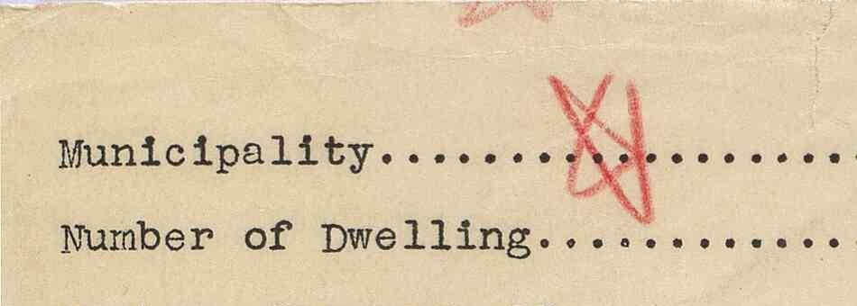
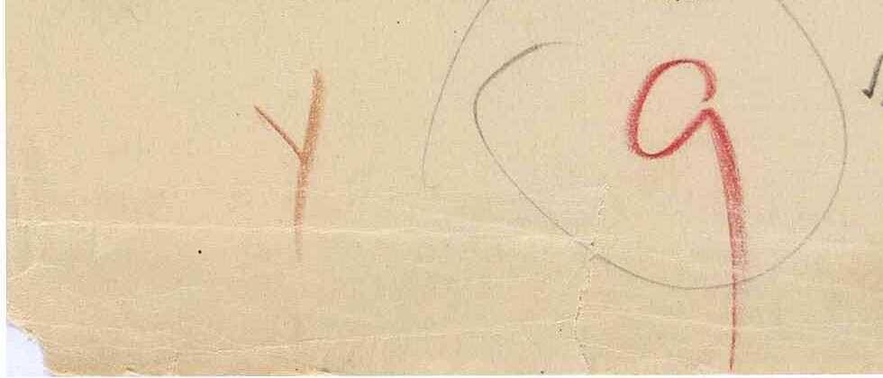

**Noise — circles several fields at once**, not one value:

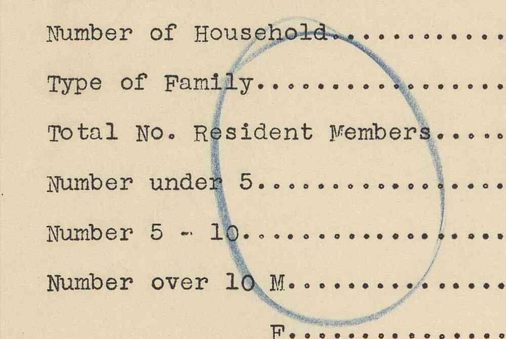

**Meaningful — FR-06 strike** (per IT-93's hand-classified manifest;
`negated: true`, `status: "no_data"`, per D011/D023):

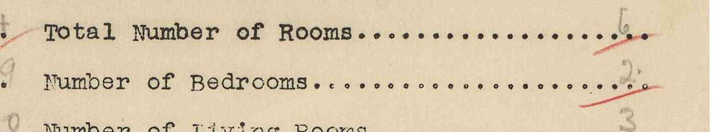
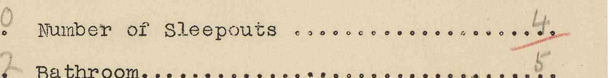
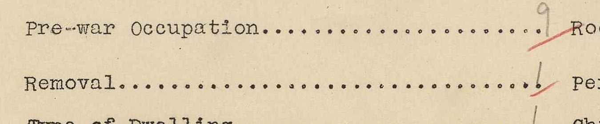
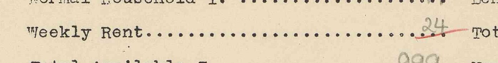
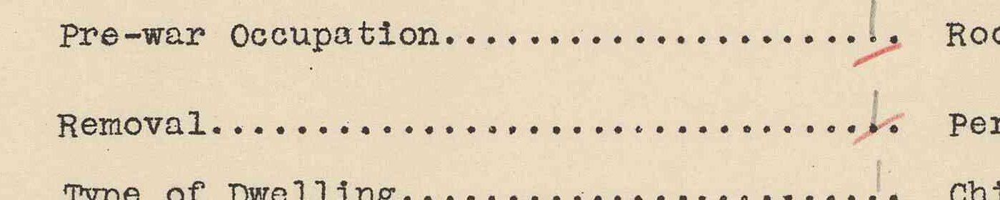
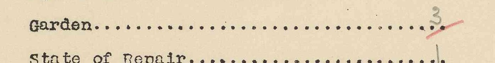

(`r01`'s "Number of Living Rooms" is a similar mark the manifest leaves
unclassified — not cited as an example.)

**Meaningful, not FR-06 — correction** (struck value with a replacement
written beside it):

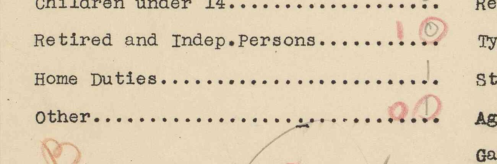

### Handwritten survey front (`*-survey-front.jpg`)

**Meaningful — FR-06 strike, printed-alternative idiom** (a different shape
from the coding-card strike, same requirement — and the client's own
reference example, "internal crossed off means external WC"):

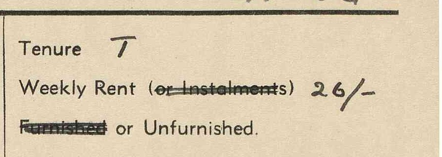
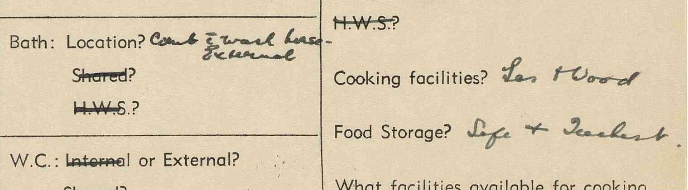

> **Gap:** FR-06 detection (IT-91/92/93) only looks at the coding-front
> card. This idiom has no detection path yet.

**Meaningful, not FR-06 — correction** (struck word, corrected):

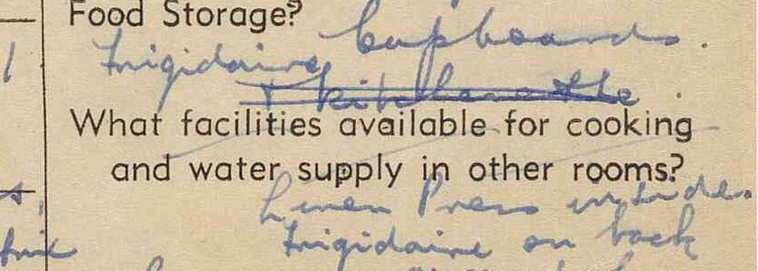

**Meaningful — FR-09 slash**, one blank cell at a time:

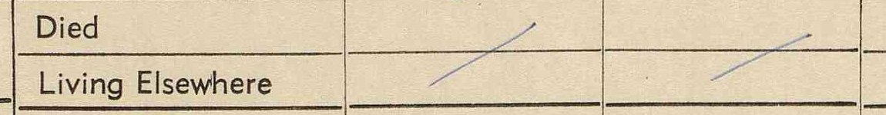

> **Unresolved:** the "Father" column's Died/Living Elsewhere cells carry red
> cursive text instead of an answer or a slash — likely an unrelated coding
> note, not classified here.
>
> 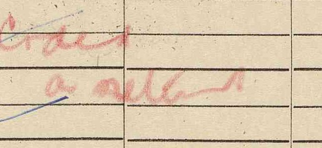

## Client provenance

Client Meeting 1 (06/08/2026): "Annotations of unknown purpose scattered
throughout: treat as noise." Carried into the Functional & Non-Functional
Requirements doc's Won't Have table and into US-07 (IT-58) on 18/08/2026.

## Handling of noise

Not extracted, not modelled, not in the output record, not counted as an
extraction failure.

## Open questions

- `r01`'s unclassified "Number of Living Rooms" mark.
- The unresolved red text on `r02-survey-front.jpg` (above).
- FR-06 has no detection path for the survey-front idiom — needed once FR-03
  is built.
- If a stamp or reviewer mark turns out to have a consistent meaning, narrow
  the Won't Have rather than reversing it.
