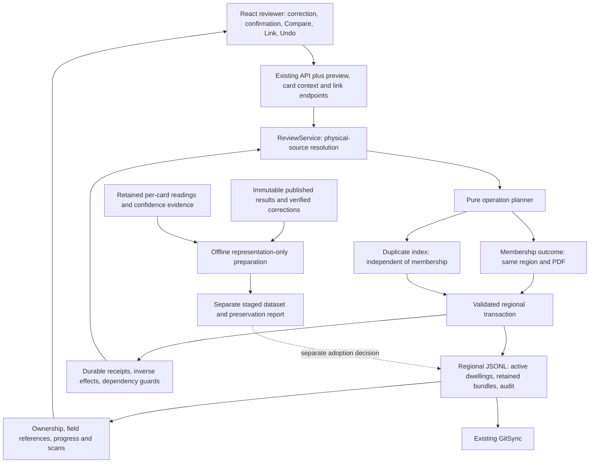

# Dwelling relinking implementation plan

Status: implementation on this branch; production data preparation/adoption remains
separate. See [the implementation/operator guide](review-relinking.md).

Planning branch: `eric-zhang/review-dwelling-relinking-plan`.

Baseline: `694b49a8186e783614e06bd8c7345b6433e1dfff` on `main`. The
GitHub connector reconfirmed this live branch head on 29 October 2026. Git fetch
was unavailable in the sandbox. This document is in an isolated managed worktree;
the unrelated `eric-zhang/documentation-edits` checkout and its staged edits are
preserved. Nothing in this plan authorizes extraction, model calls, rescoring,
publication or replacement of the production review seed.

## 1. Recommendation and agreed behavior

Make each physical coding card own its municipality, dwelling number and building
readings. Reuse existing correction controls, validation, physical IDs, regional
JSONL persistence, audit and Undo. Evaluate membership and duplicate identity
independently. All relinking stays within one region and PDF.

Agreed reviewer behavior:

- Confirm a new or changed duplicate conflict before committing, with **Save
  anyway**, **Compare** and **Go back**. An otherwise valid correction remains
  saveable. Existing duplicates show notices without repeatedly opening dialogs.
- Retain a duplicate banner with **Compare** after saving, across automatic field
  navigation, and when reopening any affected card.
- Duplicate flags do not prevent completion of assigned transcription review.
- Household-number edits alone never change dwelling membership.
- A last-card move can preserve its former supplementary evidence in a read-only
  retained bundle outside the queue. Expose the bundle from the moved card and
  restore it through eligible Undo. General reattachment editing is deferred.
- Undo checks the affected changes and their dependencies, not whether anything
  else in the region has changed. Preserve unrelated later edits and histories.

Exclude front-only primary records or queue rows, database migration, persistent
dwelling UUIDs, cross-region/PDF moves, arbitrary front splitting and individual
person reassignment. A provisional coding-only dwelling remains an ordinary
dwelling with at least one coding household.

## 2. Verified current architecture and gaps

Paths below are relative to this repository. Statements about current behavior
refer to the baseline above, not the proposed review schema.

| Area | Existing implementation | Required change |
| --- | --- | --- |
| Editing | `backend/survey/review/fields.py`: `Descriptor.identity_kind`, `valid_correction`; `service.py`: `apply_decision`. Municipality, dwelling and household editing already exist on main. | Reuse controls and validation; change ownership and structural behavior. |
| Ownership | `backend/survey/records.py`: `resolve_field`, `field_pointer`; `backend/survey/association/records.py`: `_record`. Shared building/dwelling fields belong to the first coding household; later cards lose their independent copies in grouped exports. | Store and resolve every card's own fields. |
| Identity | `service.py`: `identity_ids`, `rebuild_identity_ids`, `identity_alias`, `identity_note_topology`. Derivation uses a shared dwelling number; corrections update IDs and note references without regrouping. | Derive from per-card readings and resolve new structural dependencies physically. |
| Duplicates | `service.py`: `check_identity_collisions` rejects new collisions; `identity_issues` computes warnings from region-wide counts. | Permit confirmed corrections; persist per-card flags; use region/PDF boundaries and peer context. |
| Persistence | `records.py`: `RecordStore.save_record` rejects ownership changes; `save` validates and replaces an entire regional file. | Add an explicit structural service path using `save`; keep ordinary save protections. |
| Audit/Undo | Field histories, `audit_index`, `apply_decision`, `undo_latest`, and restart-safe request replay already exist. Some identity effects use guarded indexes. | Extend for physical membership changes, retained evidence and standalone link events. |
| Queue | `backend/survey/review/flags.py`: `build_flags`, `_pointers`; `service.py`: `replace_queue`, `rebuild_progress`, `dwelling_id`. Later-card building fields are omitted; dwelling IDs derive from coding membership. | Generate per-card fields and rebind physical field references after structural changes. |
| Frontend | `frontend/src/App.tsx`: `submit`, `advanceWithinCard`, `openItem`; `frontend/src/api.ts`: `Item`, `Saved`. Saving advances within the selected card and updates local progress. | Add confirmation/comparison/link flows and refresh complete affected state. |
| Scans | `backend/survey/review/api.py`: `scan` resolves through queue references. | Register read-only scans for unqueued peers and retained evidence. |
| Sharing | `backend/survey/review/sync.py`: `WriterLock`, `GitSync`; `docs/decisions/D029-review-persistence.md`. One writer per checkout; disjoint-region sync; overlapping regional changes stop. | Retain these boundaries and rebuild expanded indexes after incoming updates. |

### Corpus checks and handoff corrections

The read-only investigation reproduced 44 populated regions, 5,375 dwellings,
5,430 unique coding cards, 978 unplaced coding-only records, 43 multi-household
groups, 202 groups with multiple fronts and five municipality-mismatch groups.
Each populated region currently has one PDF; no dwelling spans PDFs. These facts
do not justify inferring municipality from a PDF or omitting boundary checks.

- Current export readings yield 246 duplicate identity combinations across 40
  regions, affecting 545 cards. Recompute after recovering independent dwelling
  numbers; current grouped numbers are not independent per-card evidence.
- The handoff's 114 unplaced records with candidates uses shared municipality.
  Checking every card's municipality gives 120; the additional six point to the
  mixed-municipality group at `results/216463.jsonl:38`. Both methods find 23
  cases with multiple candidate groups. None is a verified link.
- The retained archive matches SHA-256
  `3df4692d996e97acb14e911833e87fc98a6b8378545c36e30cad26d71238258e`.
  Its 6,350 front readings, 73 pages now exported as coding, 1,643 unlinked cached
  front readings and 20 later published fronts absent from it were reproduced.
  These are run classifications, not visually verified front classifications.
- The archive lacks 80 published coding sources. Three are later cards needing
  omitted-building-field recovery: 216428 page 49, 216460 page 378, and 216463
  page 279. Published first-card fields cover the corresponding ownership gap
  for the other 77 sources; the preparation audit must still check their needs.
- There are zero field review histories and 34 corrected field occurrences in
  the canonical export. Four corrected municipality occurrences are identical
  aliases. Check all 34 original source-path/payload mappings, even when two
  mappings collapse onto the same per-card field.
- The live `review-data` head checked during investigation is
  `291db66fa71bc9cf8edcae38bc03899564214099`. Its published results tree matches
  the baseline. Actual reviewer checkouts may have uncommitted work and must be
  checked before adoption.

The handoff's strict region-wide structural Undo suggestion is superseded by
section 6. Its proposal to block last-card moves indefinitely is superseded by
the agreed retained-bundle resolution. The handoff remains discussion context;
this document records the current decisions.

## 3. Proposed architecture



Use a small pure planning module shared by preview and commit. It returns
membership outcome, duplicate changes, evidence disposition and affected physical
cards. It performs no writes, extraction or scoring.

## 4. Data contracts and invariants

### Review schema and field ownership

Introduce review envelope `0.7.0` in `schema/record-envelope.schema.json`, without
changing the published extraction format's global version constant. Shared
validators retain historical-format support; the new reviewer requires prepared
review data rather than old/new runtime fallback ownership rules.

- Every household owns `municipality`, `dwelling_no`, `house`, its existing
  household/coding fields and its physical coding source. Populate the 20
  building fields from that source or mark them explicitly omitted.
- Remove editable dwelling-level coding aliases in the review format. Preserve
  their source-to-target mappings in the preparation report.
- Keep front-derived address, handwriting, notes and existing person placement
  as supplementary evidence. A move must not give the card another card's
  building readings, confidence or provenance.
- Add household `flags[]` using existing string vocabulary for current per-card
  issues, optional relinking state, retained bundles and standalone link history.
- Use review-specific pointer mapping; do not globally rewrite extraction
  `FIELD_MAP` or convert published extraction artifacts in place.

### Identity and duplicate flags

Physical identity is the existing `physical_card_id(region, PDF basename, page)`;
every physical coding card occurs exactly once. Never key ownership by
`record_id`, array index, address or current dwelling ID.

A duplicate full identity is the normalized tuple:

```text
(region, PDF basename, municipality, dwelling number, household number)
```

Reuse `build_record_id` normalization, including leading-zero equivalence and
uppercase dwelling suffixes. Incomplete identities do not collide as nulls.
In the new review format, `record_id` is derived and nonunique when complete,
and null when incomplete. It grants no identity priority or verified link.

Persist `duplicate_record_id` in every affected household's `flags`. Derive peer
lists from the regional index rather than maintaining reciprocal stored lists.
Recompute old and new identity buckets after municipality, dwelling-number or
household-number edits and Undo; clear the current flag when a bucket becomes a
singleton. Initialize flags for duplicates already in the staged seed.

Keep dwelling-level extraction flags as historical context. Current notices and
routing must not mistake a historical duplicate flag for an unresolved conflict.
Validate persisted current flags against the derived index on loading prepared
data. Duplicate changes do not select a dwelling, merge cards or block completion
of assigned transcription work.

### Membership and supplementary associations

Evaluate candidates within the same region and PDF using each card's municipality
and dwelling readings. Household number, identity duplicates, confidence rank or
proximity alone must not establish a link.

- Preserve a compatible existing association. A municipality correction on a
  sole card does not by itself prove its existing front association wrong.
- Do not allow the edited card alone to manufacture corroboration for an
  existing group contradicted by its front or other coding evidence.
- Automatic moves require one compatible front-bearing destination without
  unresolved competing or contradictory association evidence. Mixed/incomplete
  evidence and multiple candidates require manual selection.
- Coding-only matches are manual candidates. No destination permits a
  provisional coding-only dwelling; a correction does not trigger a seed-wide
  association rebuild.
- Transfer the complete coding household with its own readings. Leave the
  source's supplementary evidence there while another coding household remains.
- Do not automatically transfer individual person rows. No current
  multi-household group contains persons, but a future departing household
  carrying source-derived persons requires an ownership-pending outcome.

Notes must remain anchored to physical front/back provenance. A derived
`household_id` alone cannot identify an owner when coding IDs repeat. Preserve
existing references and only update them through an unambiguous physical owner;
do not infer a new household association from an equal ID.

### Retained bundles: preservation, visibility and limits

When the last coding household leaves, the old dwelling cannot remain a primary
record with no coding card. Preserve its complete supplementary payload in a
`retained_supplements[]` bundle carried with the moved household in the same
regional JSONL. Include front/back sources, address, handwriting, notes, person
rows, original row placement, original association context, flags and histories,
plus the detachment operation ID and reason.

The moved household has custody of the bundle; the bundle is not evidence for its
new dwelling. Display it separately as **Retained evidence from former dwelling**
with read-only structured data and scans. Do not include it in active front
counts, destination matching, ordinary dwelling summaries or assigned queue
completion. Surface retained-bundle counts so completed transcription work is
not presented as completed evidence association.

**Example:** move coding page 102 from dwelling A into dwelling B. A's front 100,
reverse notes, address and person rows remain stored in a bundle. B retains its
own active evidence; front 100 is not silently attached to B. Eligible Undo moves
102 back, recreates A if needed, and restores front 100 and the other evidence.

**Deferred reattachment** means v1 does not offer a general **Attach this retained
bundle to dwelling C** action, partial front splitting, or editing while retained.
It does not mean the bundle is deleted or automatically reattached later. Undo
restores the prior arrangement; attaching to a different arrangement is a future
association operation. A supplementary-field Undo whose field is currently
retained requires restoration first, rather than silently editing archived data.

If relevant later structural changes block Undo, retain access to the complete
bundle and show the blocking dependency. Reversing that dependency may make Undo
eligible again. Otherwise operator reconciliation is required; no general repair
editor is promised in v1. Do not suggest that merely doing unrelated review work
makes evidence irrecoverable.

Centralize active/retained evidence traversal. Include retained live histories in
the audit registry exactly once, validate their original field semantics, and
exclude inverse snapshots from live-field/scoring traversal. This avoids accidental
double-counting or treating archived evidence as current destination evidence.

## 5. API, reviewer flows and outcome table

Keep existing decisions and Undo endpoints. Add:

- `POST /api/review-items/{item_id}/preview`: read-only planning at
  `expected_version`, returning membership outcome, duplicate peers and a conflict
  signature bound to the correction and regional version.
- `GET /api/cards/{card_id}`: read-only context and registered scans, including
  unqueued peers and retained evidence.
- `GET /api/cards/{card_id}/link-candidates`: current-version candidate context.
- `POST /api/cards/{card_id}/link`: versioned, idempotent linking, addressed by
  a physical destination coding-card anchor, or an explicit provisional target.

Extend decision requests with optional duplicate confirmation. Commit recomputes
the plan independently; a changed version invalidates confirmation. An omitted
confirmation returns a confirmation-required response with no write and an
available **Save anyway** action. Preview itself creates no durable operation.

Compare identifies peer region/PDF/pages, identity readings, building differences,
current dwelling address/front pages and scan access. It works for unqueued cards.
Keep the saved-result banner visible across automatic field navigation and show
the current conflict on every affected card when reopened.

| Outcome | Saves and moves | Reviewer notice | Undo |
| --- | --- | --- | --- |
| Existing membership still fits | Correction and derived identity; membership unchanged. | Saved confirmation and updated context. | Reverse field effects, preserving unrelated edits. |
| Clear destination, safe source | Correction plus complete coding-household move in one transaction. | Destination explanation; reopen same physical card. | Reverse correction and membership together if dependencies permit. |
| No destination, safe source | Retain/create provisional coding-only dwelling; remove empty evidence-free source. | No matching dwelling; Link available. | Restore prior membership and correction. |
| Ambiguous destination | Correction saves; membership remains pending. | Separate ambiguity notice and candidate scans. | Reverse correction/pending effects. |
| Duplicate identity | Confirm then save correction and flags for all peers; membership evaluated separately. | Dialog, then banner and Compare. | Recompute duplicates; restoring a previous duplicate is allowed. |
| Ambiguous plus duplicate | Confirm/save correction and peer flags; keep relink pending. | Both issues, without treating either as the other. | Reverse correction; recompute current peers. |
| Last-card move would strand evidence | Correction saves first; membership pending until explicit retained-evidence move. | Explain retention and offer that move. | Correction and later move are separate operations. |
| Confirmed retained-evidence move | Move coding household; retain old evidence; remove empty primary source. | Destination plus retained-bundle access. | Restore former membership/evidence; keep earlier correction. |
| Household-number edit only | Correction, ID/reference effects and duplicate flags; no membership change. | Duplicate confirmation where needed. | Restore number; recompute derived identity and duplicates. |
| Invalid, stale or precommit write failure | No partial correction/move/flags/audit commit. | Preserve draft; reload or retry appropriately. | No new Undo target. |

Manual linking does not edit transcribed numbers, merge card payloads or establish
an identity winner. The explicit last-card action may retain evidence even when
the destination already has its own evidence: the two evidence sets remain
separate, and no supplementary merging or reattachment occurs.

## 6. Transactions, audit, retries and dependency-scoped Undo

### Save boundary

Under the existing store lock:

1. Check a durable request receipt before stale checks or current pointer
   resolution, so a moved card's successful request remains replayable.
2. Validate submitted regional version and on-disk digest.
3. Resolve physical owners, recompute outcomes and validate confirmation.
4. Build the copied regional candidate containing field, membership, current
   peer flags, retained evidence and one audit event.
5. Fully validate and prepare replacement indexes.
6. Atomically replace JSONL through `RecordStore.save` and publish indexes only
   after the durable write succeeds.
7. Rebind assignments, refresh ownership/progress/groups/scans and reopen the
   same physical card using its current membership.

Keep local-save and upload status separate. A network/response failure may occur
after a successful commit: it is an uncertain response, not proof the old file
remains. Retrying the same request/body replays the durable result without a
second move, bundle or audit event. Changed reuse returns `request_conflict`.
Stale requests cannot silently overwrite newer work.

Keep existing writer locks, one-owner-per-region practice and same-region Git
conflict stops. No sidecar transaction protocol or automatic regional merge is
introduced. Incoming synchronization rebuilds the expanded indexes.

### Operation history

Extend correction events with optional structural effects; store standalone link
events with the physical coding household. Register each event once across field,
link and retained histories. Record reviewer, time, exact request, physical
sources, source/destination member sets, changed field/reference paths, retained
bundle references and sufficient envelope metadata to reconstruct removed groups.

Record inverse effects without recursively copying histories. Identify fields,
households and supplementary sources physically, with logical paths for fields;
array indexes and membership-derived dwelling IDs are not durable ownership keys.

### Revised Undo eligibility

Do not persist or require a whole-region post-operation hash for Undo eligibility.
Every Undo still submits the latest regional `expected_version` for concurrency,
but that version is distinct from whether the earlier operation can be reversed.
A stale request reloads and reevaluates; it does not permanently lose Undo.

For each operation, persist its exact inverse write set and the structural
dependencies needed to apply it. At Undo time:

- Resolve the moved card and affected groups from physical IDs. Check that the
  card is still in the expected resulting group and the affected source/target
  member sets and supplementary ownership topology match the saved operation.
- Check the field decision being reversed is still applicable. Verify only the
  field payloads or explicit associations that the inverse will replace, plus
  municipality/dwelling dependencies used for the link. A later acceptance or
  correction on the same target field must be undone first.
- Require an archived bundle to remain uniquely present, retained and intact
  before restoring it. Reject changed front/back association, consumed/missing
  bundles, or unsafe reconstruction of an old group.
- Apply inverse field/structure changes to a copy of the current region, carrying
  existing household objects and histories instead of replacing whole saved
  household/dwelling snapshots. Preserve later unrelated field edits, including
  building fields on the moved card and untouched note text in affected groups.
- Recompute IDs, note projections where physically unambiguous, and duplicate
  buckets from the resulting current readings. Do not blindly restore old peer
  flags or derived IDs over later independent household-number corrections.
- Append the reversal event to the candidate, validate and save the complete
  region atomically, and refresh all affected indexes after commit.

Unrelated edits elsewhere in the region, record ordering, and unrelated field
histories do not block Undo. Later changes to affected membership, municipality/
dwelling link dependencies, or evidence ownership do. Report the specific card,
association or later operation that blocks reversal, not a generic region-changed
message. Where an intervening dependent operation is itself undone and the
required state is restored, reevaluate the earlier Undo; the mere presence of
later history is not a permanent veto.

Keep existing ordinary field-level latest-decision/dependency checks. Undo of a
combined correction and automatic relink reverses both. Undo of a separate manual
link preserves the earlier number correction. Restoring a former duplicate is
permitted and surfaces the current banner without an identity-winner policy.

**Examples:** after moving page 175, correcting an unrelated card or its own room
count does not prevent moving it back; that later room correction survives. If
page 175 is subsequently moved again, or the affected group's front ownership is
changed, Undo must resolve that dependency first. If another card joins the
affected group, the exact membership guard blocks automatic reversal rather than
guessing how to preserve a new structural arrangement.

### Queue and navigation

Rebind valid assignment references by physical source and semantic field after
structural saves and incoming sync. Keep genuinely invalid assignments diagnostic.
Retain supplied assignment ordering and scope rather than regenerating/reranking
the queue on each save. Refresh all affected groups and peer issues before
advancing; current dwelling IDs may change. Completion concerns assigned fields;
retained evidence and pending links need separate visible counts.

## 7. Offline preparation and preservation

Implement a separate representation-only preparation command. Do not run
`scripts/rebuild_cached_results.py` unchanged: it reconstructs associations and
calls scoring/merge helpers. Its `cached_readings` parsing may be reused.
`backend/survey/merge_runs.py:score_household` documents ownership/confidence
behavior but is not authorization to rescore the corpus.

Preparation must:

1. Pin published inputs, retained artifacts and correction-manifest hashes.
2. Preserve existing membership and supplementary associations initially.
3. Relocate first-card coding fields and recover later-card omitted fields from
   their own physical-source artifacts.
4. Preserve published values, calibrated confidences, coding-card scores,
   classification decisions, protected payloads, notes and people.
5. Emit a source-path-to-target preservation report, recovery/missing-evidence
   inventory and deterministic staged output outside published `results/`.
6. Initialize current duplicate flags and provisional context without regrouping
   the seed. Keep unmatched fronts outside primary review records.

Reuse existing field-specific confidence evidence for newly exposed fields only
where it actually matches that source and field. Otherwise use null confidence;
never borrow another card's confidence or rerun the older scoring path. Report
the resulting queue increase as part of adoption readiness.

Resolve the missing later-card sources for 216428 p49, 216460 p378 and 216463 p279
against later Gemini artifacts. Qwen comparison exports do not establish missing
Gemini building readings; one also shares its first-card building envelope.
Missing primary evidence becomes omitted/null-confidence fields with a visible
missing-reading issue, not guessed values. A staged dataset still containing
such gaps needs an explicit adoption decision.

Validate all 34 corrected occurrence mappings; explain the four duplicate
municipality-alias mappings. Preserve the original files and merge manifest
unchanged; the preparation manifest describes relocation/recovery/derived-ID
changes separately. No review-history migration is assumed, but actual production
review work must be rechecked before any fresh-seed adoption.

## 8. Phased implementation and meaningful validation

| Phase | Likely components and work | Acceptance |
| --- | --- | --- |
| 1. Schema/ownership | Schema, review-specific pointer mapping, `records.py`, review fixtures. | All coding fields resolve to their physical card; historical published schemas still validate; old review format receives a preparation requirement. |
| 2. Preparation | New staging script, cache loaders, preservation reporting. | Deterministic; associations unchanged; every coding card retained once; all protected mappings pass; missing evidence explicit; no extraction/scoring calls. |
| 3. Duplicates | Review planner/service, flags, preview/decision API, React types/dialog/banner/Compare. | All three correction types save after confirmation; every peer flags/clears consistently; duplicate issues do not block assigned completion. |
| 4. Membership | Pure outcomes, structural service saves, candidates/manual links, source-aware refresh. | Clear moves atomic; ambiguous cases pending; unmatched cards provisional; household-only edits never move; no card merging. |
| 5. Retention/Undo | Bundle registry/viewer, operation events, inverse write sets and dependency checks. | Last-card moves preserve complete evidence; restart/retry does not duplicate it; Undo preserves unrelated later edits while refusing changed dependencies. |
| 6. Adoption rehearsal | Synthetic browser/API flows and disposable review checkout; corpus preservation reports. | Failures, stale writes, sync conflicts, restarts and rollback demonstrated before separate production approval. |

Concrete corpus cases:

- `results/216421.jsonl:41`: pages 175/179 retain their own seven/six-room
  readings before moving, after moving and after Undo.
- `results/216413.jsonl:13`: pages 50/54 remain separate with identical readable
  identities despite current null stored IDs.
- `results/216413.jsonl:104`, `:105`, `:107`: page 331 sees competing groups
  with front 332 and fronts 338/341/344/347; show coding peers 334/340/343/346
  without choosing an identity winner.
- `results/216463.jsonl:38` through `:44`: per-card municipality candidates
  remain manual because the prospective destination is mixed.
- The three missing-cache later cards exercise honest recovery gaps.

Test the full outcome table, including overlapping ambiguous/duplicate and
retained-evidence/duplicate outcomes. Cover suffix/zero normalization, incomplete
identity, different region/PDF noncollisions, pre-existing duplicates, third-peer
creation/removal, and unaffected confidence/provenance.

Undo regressions must explicitly demonstrate:

- An unrelated save in the same region, including after restart, does not block.
- A later room/building edit on the moved card survives structural Undo.
- Untouched household/field histories and applicable note text survive.
- Later independent household-number changes survive where link dependencies
  remain valid; derived IDs and duplicate flags reflect the resulting readings.
- Changed source/target membership, edited target identity decisions, altered
  front/back ownership and missing/changed bundles block with specific reasons.
- Undoing a dependent move can make an earlier move eligible again.
- A stale Undo refreshes and reevaluates against the newest version; a lost
  response replays once; failures leave no partial reversal or audit change.
- A manual-link Undo keeps the earlier correction and restores any retained
  evidence to the former source without assigning it to the destination.

Also test flush/replace failures, postcommit response/refresh failures, exact
request replay across restart, conflicting reuse, stale confirmation, external
file changes, local-versus-upload state, same-region sync conflicts, disjoint
sync, unqueued peer scans and queue pointer rebinding. Retained evidence must
never contribute to active matching, front counts or queue completion.

Run focused backend/API tests, React tests and synthetic browser flows, then
Linux/Windows persistence checks, schema validation and the broader existing
suite. Preparation tests must prove prohibited model/extraction/scoring entrypoints
are not called. The prior investigation baseline passed 162 focused backend and
80 focused frontend tests; these are existing-behavior evidence, not validation
of the proposed feature. Implementation checks and their limits are recorded in
[the implementation guide](review-relinking.md#implementation-validation-29-october-2026).

Before adoption, recheck live `review-data`, actual reviewer checkouts and
uncommitted decisions. If review work exists, stop the fresh-seed replacement
path and reconcile it. Preserve the old seed in normal Git history. Rollback
before reviewer work can restore it; rollback afterward must retain/reconcile
new decisions, never discard them. Publication/replacement remains separately
authorized and is not part of this implementation task.

## 9. Tradeoffs, decisions and outstanding work

| Decision | Recommendation and consequence |
| --- | --- |
| Duplicate UI | Precommit confirmation plus persistent Compare banner. More interaction only for new/changed conflicts; valid readings remain saveable. |
| Duplicate schema | Current household flags plus derived peer index reuse existing vocabulary without a persistent reciprocal conflict graph. Historical dwelling flags remain distinguishable. |
| Retained evidence | Same-file read-only bundles preserve data and atomicity without front-only review rows. They are intentionally unavailable as active destination evidence or general reattachment targets. |
| Undo | Inverse changes plus physical dependency guards preserve unrelated edits. More precise validation than a regional hash; dependent structural changes can still require reversal/reconciliation. |
| Seed preparation | Preserve published associations and scores; transform representation only. Requires retained artifacts and honest missing-evidence reporting, rather than a broad cached association rebuild. |
| Concurrency | Existing region versions, single-checkout writer lock and region ownership stay. Stale retries reload; overlapping regional Git work requires reconciliation. |

Resolved user choices are recorded in section 1. The region-wide Undo restriction
is expressly removed by the 29 October request. Routine implementation choices
should follow the contracts above; no new database or detached-evidence sidecar
is needed.

Outstanding evidence: later primary artifacts, field-specific confidence evidence,
and the actual state of reviewer checkouts before adoption.

Implementation defaults adopted after the request to implement this plan:
source-validated **Fix identity** actions are available on unqueued peer identities,
with voluntary corrections excluded from assigned totals. Automatic moves require
a homogeneous compatible group with front-number corroboration and no competing
candidate; coding-only, unknown-front-number and mixed groups require manual
selection. Existing non-null note links acquire a physical owner only when their
original group resolves it uniquely; explicitly owned notes cannot silently be
left behind by a non-final household move. Municipality is never inferred from PDF.

General reattachment of retained bundles remains deferred. It is a distinct future
association workflow, not a synonym for preservation or Undo, and is not added by
the request to make Undo less restrictive.
